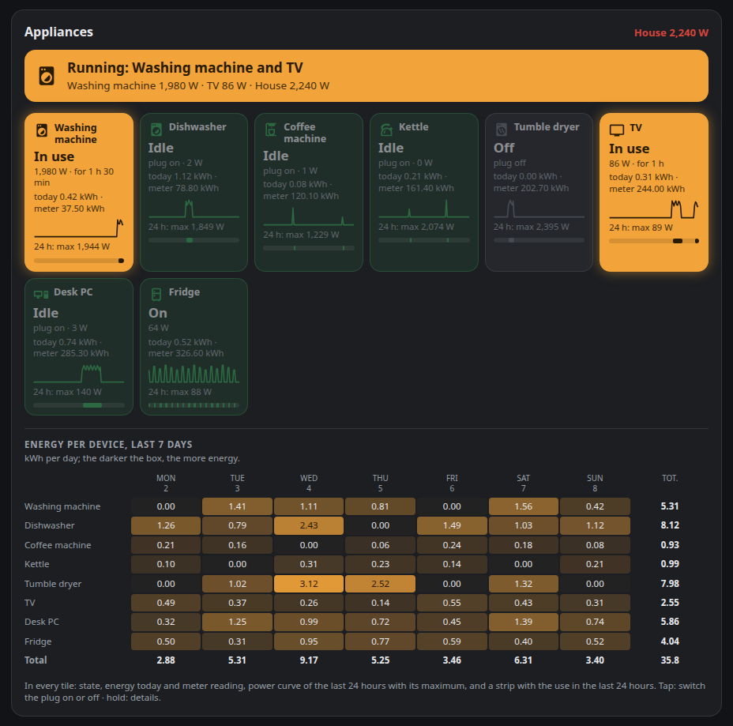
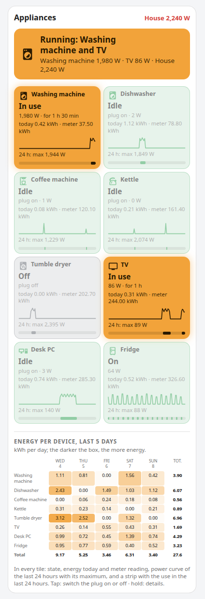

# Appliance Energy Card

A Home Assistant dashboard card for the appliances on your smart plugs. At a glance: **what is running now**, how
much it draws, and how much energy each appliance used in the last days.



- A banner on top: *Running: Washing machine and TV*, with the power of each one and, if you want, of the whole house.
- One tile per appliance. Appliances in use are in full colour; idle or switched-off ones are dimmed, so your eye goes
  straight to what is running.
- In every tile: state, power, how long it has been running, energy used today, meter reading, the power curve of the
  last 24 hours with its maximum, and a strip with the times it was in use.
- Tap a tile to switch its plug on or off (never for always-on appliances such as the fridge; or never at all, with
  `tap: details`); hold it for the details.
- Below, a table with the energy of every appliance, day by day, for the last 7 days: the darker the box, the more
  energy.
- No animations, works at phone width, follows your light or dark theme. English and Italian.

| On a phone |
|---|
|  |

## Requirements

- Home Assistant 2024.8 or newer.
- For every appliance, a **power** sensor (W) and/or an **energy** sensor (kWh), as most smart plugs provide.
- The energy sensors need `state_class: total` or `total_increasing`, so that Home Assistant keeps long-term
  statistics for them: the energy of today and the 7-day table are read from those statistics. Sensors that appear in
  the Energy dashboard already have it.

## Installation

### Marketplace (Home Assistant 2026.11 and newer)

Until the card is in the default catalogue, add it by link: open **Settings → Marketplace**, choose
**Add from link**, paste `https://github.com/AldebaranPrimo/appliance-energy-card`, then install
**Appliance Energy Card**. The dashboard resource is added for you. Reload the page in the browser afterwards.

### HACS (before 2026.11)

HACS → three dots → **Custom repositories** → add `https://github.com/AldebaranPrimo/appliance-energy-card` with type
**Dashboard**, then download **Appliance Energy Card**.

### Manual

Copy `appliance-energy-card.js` to `/config/www/`, then add a dashboard resource (Settings → Dashboards → three dots →
Resources) with URL `/local/appliance-energy-card.js` and type **JavaScript module**.

## Configuration

The shortest configuration has no options. The card reads the **Individual devices** of your Energy dashboard
(Settings → Dashboards → Energy), and for each one looks for a power sensor and a switch on the same device:

```yaml
type: custom:appliance-energy-card
always_on: [Fridge]          # optional: appliances that must always draw power
```

Or list your appliances yourself:

```yaml
type: custom:appliance-energy-card
title: Kitchen and laundry
house_power: sensor.house_power        # optional: total power of the house, shown in the header
devices:
  - name: Washing machine
    icon: mdi:washing-machine
    power: sensor.washing_machine_power
    energy: sensor.washing_machine_energy
    switch: switch.washing_machine
    threshold: 15                      # in use above 15 W
  - name: Dishwasher
    power: sensor.dishwasher_power
    energy: sensor.dishwasher_energy
    in_use: binary_sensor.dishwasher_running   # your own "in use" sensor, if you have one
  - name: Network rack
    power: sensor.rack_power
    always_on: true                    # warn when it drops to almost zero
```

### Card options

| Option | Default | Description |
|---|---|---|
| `devices` | the individual devices of the Energy dashboard | List of appliances, see below. |
| `exclude` | none | With automatic devices: energy sensors or names to leave out. |
| `always_on` | none | List of energy sensors, power sensors or names of appliances that must always draw power (fridge, freezer, network). Works also with automatic devices; a device's own `always_on` wins. |
| `tap` | `toggle` | `toggle`: a tap switches the plug on or off (never for `always_on` appliances); `details`: a tap only opens the details. |
| `title` | *Appliances*, translated | Card title. |
| `house_power` | none | Power sensor of the whole house, shown in the header (green, amber above 800 W, red above 2000 W). |
| `house_levels` | `[800, 2000]` | Watts at which the house power turns amber and red. |
| `threshold` | `10` | Watts above which an appliance counts as in use, for appliances without their own `threshold` or `in_use`. |
| `days` | `7` | Days in the table. |
| `show_tiles` | `true` | Show the tiles. |
| `show_table` | `true` | Show the table of the last days. |
| `language` | Home Assistant language | `en` or `it`; other languages fall back to English. |

### Device options

| Option | Default | Description |
|---|---|---|
| `name` | the switch or sensor name | Name shown on the card. |
| `power` | a power sensor on the same device as `energy` | Power sensor (W). `""` for none. |
| `energy` | none | Energy sensor (kWh), for today's energy, the meter reading and the table. |
| `switch` | a switch on the same device | Plug to switch on and off with a tap. `""` for none: the tap then opens the details. |
| `in_use` | none | A `binary_sensor` that is `on` while the appliance runs. Without it, the card uses `power` above `threshold`, also for the 24-hour use strip. |
| `threshold` | card `threshold` | Watts above which this appliance is in use. |
| `always_on` | `false` | For things that should always draw power (fridge, network): shown as *On*, and in full colour as *No power* when the power drops to 1 W or below (or to this device's `threshold`, if set). A tap never switches their plug. |
| `icon` | the switch icon, or guessed from the name | Any `mdi:` icon. |

### What the colours mean

| Tile | Meaning |
|---|---|
| Full amber, *In use* | Running now. |
| Full amber, *No power* | An `always_on` appliance that dropped to almost zero (1 W or less). |
| Grey, *Unavailable* | The plug or the sensor is not responding. |
| Dimmed grey, *Off* | Plug switched off: that is your choice, not an alarm. |
| Dimmed green, *Idle* / *On* | Fine. |

## Translations

Texts live in the `STRINGS` object at the top of `appliance-energy-card.js`. Pull requests with new languages are
welcome.

## More cards

Other cards in the same style:

- [Bin Day Card](https://github.com/AldebaranPrimo/bin-day-card): which bins to put out tonight and the next collection days.
- [Battery Check Card](https://github.com/AldebaranPrimo/battery-check-card): finds every battery in your home and shows which ones to replace now.
- [Tractive Pet Card](https://github.com/AldebaranPrimo/tractive-pet-card): your pet's activity goal, collar and history from the Tractive integration.

## Licence

[MIT](LICENSE)
